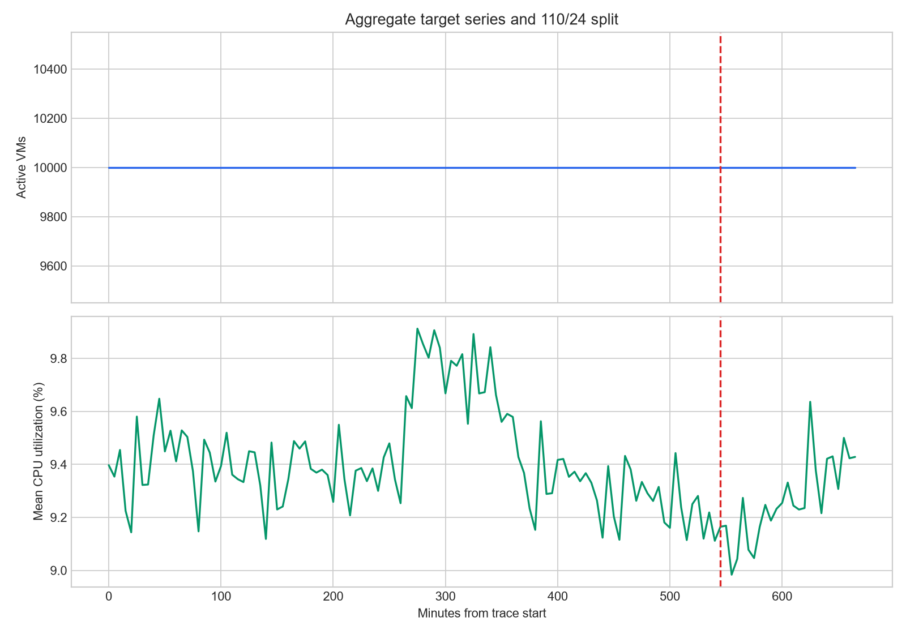
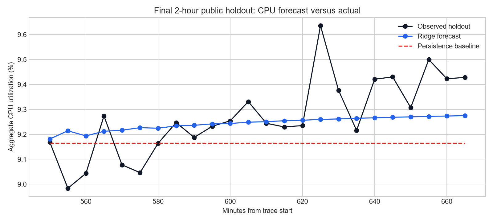
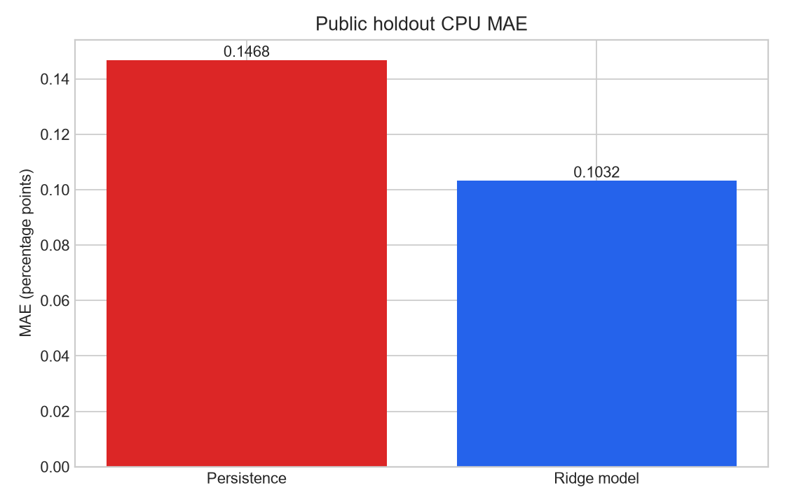

# Cloud Workload Forecasting Challenge Report

## Executive Summary

The supplied `data-v1` release contains 10,000 VMs and 134 five-minute
timestamps (1,340,000 VM-level observations). The data has no missing required
fields, no duplicate `(timestamp, vm_id)` pairs, and a regular 300-second
cadence. Every timestamp contains all 10,000 VMs, so active fleet size is
constant in this release and a persistence forecast is appropriate.

Aggregate CPU utilization is also highly stable: its observed range is
approximately 8.98% to 9.91%, with a mean of approximately 9.39%. The
implemented pipeline uses persistence for `active_vm_count` and a leakage-safe
autoregressive Ridge model for aggregate CPU. The final 24 timestamps are
never used for fitting or model selection.

## Data understanding and preprocessing

The pipeline in `src/data.py` reads `vm_cpu_readings.csv.gz`, validates required
columns, removes invalid rows, deduplicates VM/timestamp pairs, aggregates
distinct active VMs and mean `avg_cpu` by timestamp, sorts chronologically,
and rejects non-five-minute grids. The release was also checked against the
metadata file: it contains 10,000 metadata rows and no missing metadata
fields.

The metadata distribution is dominated by the `Delay-insensitive` category
(6,180 VMs, 61.80%) and the `Interactive` category (3,091 VMs, 30.91%),
with 729 unknown-category VMs. Virtual-core buckets are concentrated in 2
cores (7,534 VMs, 75.34%) and 4 cores (1,908 VMs, 19.08%). These segments are
useful descriptive context, but the core forecast targets are fleet-level
series as required by the assignment.

The cluster composition is predominantly dual-core (75.3%) and
delay-insensitive (61.8%). Because the majority of compute represents
non-interactive workloads, cluster operators enjoy scheduling elasticity:
transient utilization peaks can be mitigated via dynamic queue throttling
rather than costly immediate hardware provisioning.

This composition also supports a differentiated response to load. The 61.8%
delay-insensitive VMs include batch processing, backups, and asynchronous
queues, while only 30.9% are interactive, latency-critical workloads. During
short-lived CPU spikes, orchestrators can therefore throttle or pause
delay-insensitive jobs to protect interactive services without violating
customer SLAs.

Individual VM utilization is heavily right-skewed: 72.5% of instances
maintain an average CPU utilization below 10%, while only 10.2% register peak
utilization (P95) exceeding 80%. This massive headroom demonstrates
substantial opportunity for CPU oversubscription, provided the orchestrator
maintains headroom for tail-risk bursts.

The median average utilization is only 5.86%, so reserving a full physical
core for every virtual core would leave substantial capacity idle. A cloud
provider can safely pack multiple VMs onto shared physical hosts, subject to
continuous monitoring and admission controls that protect against the
minority of burst-prone instances.

Trace analysis confirms zero VM churn: 100% of the 10,000 VMs were
instantiated prior to timestamp 0 and remained active beyond timestamp
39,900. This validates why `active_vm_count` is invariant at 10,000 across
all 134 intervals, justifying a static persistence forecast of 10,000 with a
theoretical and empirical MAE of 0.0.

This is not an open system where servers spin up and down dynamically; it is a
closed, static cohort of long-running instances. Consequently, the active-VM
forecast should remain a persistence policy for this trace, rather than
introducing a churn model unsupported by the observations.

## Forecasting approach

The target series is constructed before splitting. The first 110 observations
are the public training window and the final 24 observations are the
two-hour holdout. The active VM count is forecast with the last observed value.
Aggregate CPU uses lagged values, a six-step trailing mean and standard
deviation, and short-term differences in a Ridge regression. Recursive
multi-step forecasts use only observed training values and earlier predictions,
then clip CPU predictions to the physical `[0, 100]` interval.

Run the final submission with:

```powershell
python src\predict.py --data challenge_data --output predictions.csv
```

The command writes exactly 24 chronological rows with the required columns:
`timestamp`, `active_vm_count`, and `aggregate_cpu_utilization`.

### Public holdout score

The challenge intentionally publishes the final labels, so the generated
submission can be scored after the forecast is created. This score is reported
for transparency only and was not used for fitting, tuning, or model selection:

```powershell
python src\evaluate.py --data challenge_data --public-holdout --predictions predictions.csv
```

For the current forecast, the final CPU holdout results are:

| Forecast | MAE | RMSE | sMAPE |
|---|---:|---:|---:|
| Persistence baseline | 0.146782 | 0.1848 | 1.5851 |
| Ridge autoregressive model | **0.103235** | **0.137302** | 1.1123 |

The model therefore improves CPU MAE by approximately 29.7% relative to the
persistence baseline. The active VM count has zero MAE for both approaches
because all 10,000 VMs are active at every timestamp in this release.

The machine-readable version of these scores is
[`public_holdout_scores.csv`](public_holdout_scores.csv).

### Figures







## Validation and error analysis

`src/evaluate.py` performs expanding-window validation using 24-step windows,
starting with 62 observations and moving the origin by 12 observations.
Origins are restricted to the first 110 observations, so the public holdout
cannot influence fitting, feature selection, or model selection:

```powershell
python src\evaluate.py --data challenge_data --output reports\validation.csv
```

The evaluation reports MAE, RMSE, sMAPE, persistence MAE, and normalized MAE
for both targets, plus MAE on validation points above the training 90th
percentile. The three pre-holdout CPU validation origins in this release
produce recursive 24-step MAEs of approximately 0.124, 0.182, and 0.153
percentage points. These are deliberately different from the notebook's
0.103 one-step validation score: recursive multi-step forecasting is a harder
and more production-realistic task. The final public holdout forecast is
generated separately by `src/predict.py` and is not used for model selection.
Peak-period error is included as `peak_mae` in the generated validation
report. For the active VM target, persistence is expected to be exact because
the supplied fleet count is constant. For CPU, RMSE emphasizes
occasional deviations more strongly than MAE; sMAPE avoids an unbounded
percentage error when values are small. Peak-period errors should be reported
by filtering validation rows to the highest-load observations rather than
relying on a single overall metric.

The principal failure mode is recursive error accumulation: a small CPU
prediction error becomes an input to later forecast steps. The stable fleet
and narrow CPU range reduce this risk in this release, but the approach should
not be assumed to generalize to a dataset with churn, gaps, or abrupt load
events.

## Operational recommendation

The concrete policy combines the Ridge forecast with the workload structure:

1. **Baseline allocation:** Set cluster baseline capacity using the Ridge model
   forecast of approximately **9.27%** aggregate CPU utilization.
2. **Safety headroom:** Add a safety buffer of **+3 × RMSE (+0.41%)**, raising
   provisioned capacity to **9.68%** to absorb stochastic macro-level swings
   without SLA breaches.
3. **Burst and quota safeguard:** If cluster CPU breaches the **9.5%**
   threshold, the scheduler should deprioritize or pause the **61.8%**
   delay-insensitive batch VMs, freeing instant capacity for the **30.9%**
   interactive VMs without provisioning additional physical servers.

This policy uses oversubscription for the low-utilization majority while
retaining explicit protection for tail-risk bursts and latency-sensitive
services. The 9.5% trigger is an operational safeguard for intervention; the
9.68% provisioned level includes the recommended uncertainty buffer.

Use the active-VM forecast directly for baseline capacity and add a CPU
headroom margin based on the upper validation error. A simple policy is to
provision for the forecast plus the larger of a fixed operational margin and
the recent validation RMSE; trigger review when the forecast or the upper
error band exceeds the team's utilization threshold. This favors avoiding
under-provisioning during peaks while acknowledging that excess headroom has a
direct cost. The policy should be recalibrated when fleet composition or
sampling coverage changes.

## Limitations

This challenge release spans only approximately 11.1 hours per VM and has a
constant 10,000-VM active population. It therefore cannot establish
long-period seasonality or realistic churn behavior. The final holdout is
public, but it remains excluded from the model-fitting protocol. Future work
should validate on longer traces, add calibrated prediction intervals, and
evaluate segment-specific forecasts when a dataset contains meaningful
segment-level dynamics.
